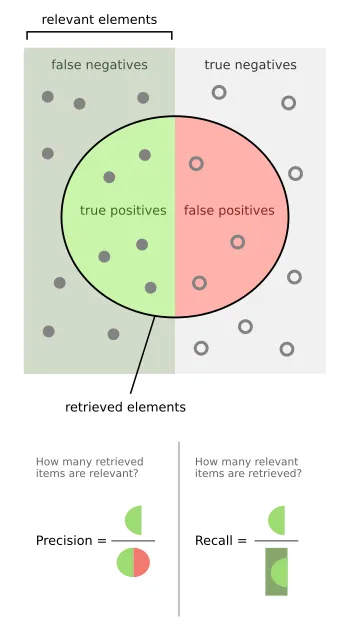

# Law Clinic Lecture — Part 2: Moderation, Design & Transparency

Comes after Part 1 (colleague): risk assessment / scoring platform design risks.

## 1. Bridge from risk assessment part by Laura
- We've just seen what it takes to do safety and risk assessments of the design and processes of platforms
- A good part of it, as said by Laura, relies on data points and processes of content moderation system of platforms.
- Not a case that DSA, for instance, states this clearly with articles:
-   DSA Art. 34: risk assessment must account for content moderation systems
-   DSA Art. 35(1)(c): mitigation = adapting content moderation processes

→ *Link: so what is content moderation, really?*

## 2. Moderation is the commodity platforms offer, not just internal process.
- Often seen as an internal process → it's not just this
- It's the commodity platforms offer (Gillespie, *Custodians of the Internet*)
  - A fundamental part of platforms' services and of their place in public discourse
  - Platforms don't just *mediate* public discourse, they *constitute* it → shaping the norms and values of online communities
  - A delicate balance of social and political values
  - An enormous part of running a platform: people, time, costs
- Public squares?
  - Platforms often present themselves as modern public squares (or are treated as such by users, politicians, institutions)
  - But they are privately owned and run for profit → moderation driven by business priorities, not neutrality or open debate
  - Nevertheless, they do play a public role
- Platforms govern the digital spaces they have established, within the limits of the law, and Moderation is part of how they govern them = design of what can and can't be said online
- So moderation is:
  - A prism for understanding what platforms are and their public role
  - Why platforms are not just intermediaries

→ *Link: what does governing through moderation look like in practice? Why building moderation processes is not just an internal ops but it does have a real impact on users*

## 3. Case: Meta, moderation decisions over the years
- Feb 2021: test reducing political content in News Feed (Canada, Brazil, Indonesia, then US)
- Aug 2021: tests expanded (Costa Rica, Sweden, Spain, Ireland)
- May 2022: less weight on comments and shares for political content; tests go global
- Jul 2022: changes implemented globally
- Sep 2024: political content setting in Content Preferences → users opt in
- Jan 2025: "More Speech and Fewer Mistakes"
  - Automated systems "made too many mistakes" → refocused on illegal and high-severity violations (terrorism, CSAM, drugs, fraud, scams)
  - Less severe violations → act only after a user report
  - Political content phased back in, personalised
- Jan 2025 is a precision vs recall decision (source: Artifacts, "Not every fish is worth it")
  - 
  - Precision: of what we removed, how much was actually violating? (avoid false positives)
  - Recall: of all violating content, how much did we catch? (avoid false negatives)
  - Fishing metaphor
    - Precision fisher: catches 20 golden fish, all golden, misses some
    - Recall fisher: wide net, catches every golden fish + many plain ones to sort
  - Before: wide net → high recall, many "mistakes" (false positives = over-removal)
  - After: narrow net on high-severity only → high precision, more harm slips through (false negatives)
  - Not a technical tweak: a choice of which error you'd rather make
    - Over-removal hurts speech → under-removal hurts safety
  - Business calculation, not public-interest principle
- Takeaways
  - Every step is a moderation design choice: what AI, which harms, who triggers action
  - Driven by political waves, not only by safety
  - Demotion is moderation too → visibility restriction, statement of reasons (Art. 17)

→ *Link: all in all, moderation is a set of design decisions. Risk assessment scrutinises them; the transparency report records them.*

## 4. The transparency report: design decisions in numbers
- So we have settled on the assumption that moderation has to do with design decisions of platform. One could even say that how you design a content moderation system, technology, and process is part of how you want to be in public and contribute to the information ecosystem.
  - Scrutinised through risk assessment (Part 1)
  - Reflected in another artifact: the transparency report
- Not "boring" metrics: evidence of how a platform governs
- Harmonised DSA template (Implementing Reg. 2024/2835, Annex I)
- Walkthrough: each section asks a design question

| Design choice | What the TR asks | Data point requested |
|---|---|---|
| Who can trigger moderation? | Sources | # orders from authorities (per Member State); # user notices; # from trusted flaggers; # own-initiative measures |
| What harms do we prioritise? | Categories | Counts per EU category / sub-category (14 + ~70) |
| Law or our own rules? | Legal basis | # actions based on law vs on T&C |
| What do we do about it? | Type of action | # removals, demotions, labels, age restrictions, demonetisations, suspensions, terminations |
| What AI do we use? | Means | # measures solely automated vs human; # notices processed solely by automated means |
| How good is our AI? | Quality | Accuracy, precision, recall (per source; per language for VLOPs) |
| How many people review? | Moderators | # internal / external moderators; # per EU language (VLOPs) |
| How fast do we act? | Timing | Median time to act on notices and orders; median time to resolve complaints |
| Can users push back? | Redress | # complaints; upheld / reversed / partially reversed; # out-of-court disputes; % outcomes implemented |
| What does it take to ban? | Repeat offenders & misuse | # suspensions for manifestly illegal content, unfounded notices, unfounded complaints |
| How do we explain it? | Qualitative | Description of automated means, safeguards, moderator training & support, governance |

- Meta check: expect fewer own-initiative actions, more notice-based ones after Jan 2025 (verify in Meta DSA reports)
- We could have a quick show of the Tremau Hub?

→ *Link: to answer these questions, you need infrastructure.*

## 5. Building the infrastructure
- Every case must carry: source, category, legal basis, action, means, timestamps, language
- Linked records: case → decision → appeal → outcome
- Account-level counters (offences, unfounded reports)
- QA loop for AI accuracy

### Example: Nima

| Design choice | Nima piece | What it does |
|---|---|---|
| Who can trigger moderation? | User Reports + Illegal Content Report Form | Intake of user notices (Art. 16), incl. trusted flaggers, tagged by source |
| | LEA Requests | Intake of authority orders (Art. 9 / 10), tracked separately |
| | Proactive Detection (AI Marketplace) | Own-initiative detection: text, image, video, audio, livestream |
| What harms do we prioritise? | Policy Configuration + DSA mapping | Each (sub-)policy mapped once to an EU infringement category → every decision auto-classified |
| | Rule Configuration + Queues | Which harms get routed, to whom, with what priority |
| Law or our own rules? | Policies (illegal vs T&C) | Policy setup separates illegal content from T&C violations |
| What do we do about it? | Actions + DSA decision types | Each action mapped to a DSA restriction type (removal, demotion, demonetisation, suspension…) |
| What AI do we use? | Rule Engine + Tremau Agents | Automated decisions vs routing to humans; agents auto-enforce predictable cases → logged as automated |
| How good is our AI? | Quality Control + Appeals Metrics | QC sampling audits decisions; precision rate per detection source; appeal overturn rate as error signal |
| How many people review? | Users, Teams & Roles + Moderators Performance | Who moderates, in which teams/languages; workload and throughput (headcount itself = HR data) |
| How fast do we act? | Moderators Performance / Cases Inflow | Median response and handling times per queue and source |
| Can users push back? | Appeals + Enforcement Portal | Users appeal decisions; outcomes (upheld / reversed) tracked and linked to the original case |
| What does it take to ban? | Account Strike System | Progressive enforcement: violations tracked per account, escalating to suspension / termination |
| | Abuse Detection Mechanism | Sanctions reporters with repeated unfounded reports (Art. 23 misuse) |
| How do we explain it? | User Notifications + EU Transparency Database | Statement of reasons to user (Art. 17) and to the EU database |
| → All of the above | DSA Transparency Reporting | Report generated from live decisions, no manual reclassification |

- Gap check: which boxes can a platform tick vs not → TBD
  - e.g. recall needs sampling of *non-actioned* content; moderator headcount lives outside the tool
